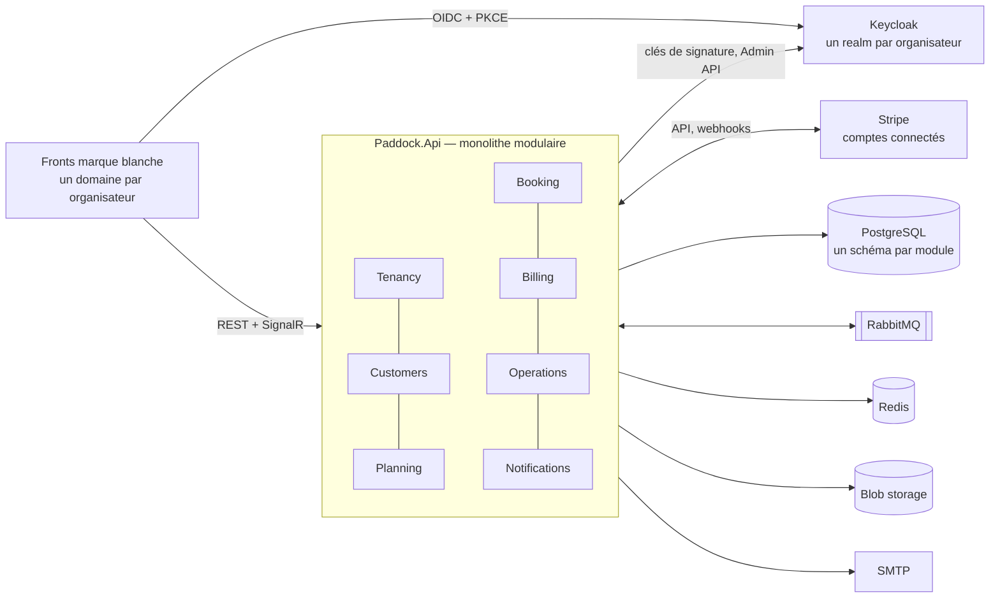
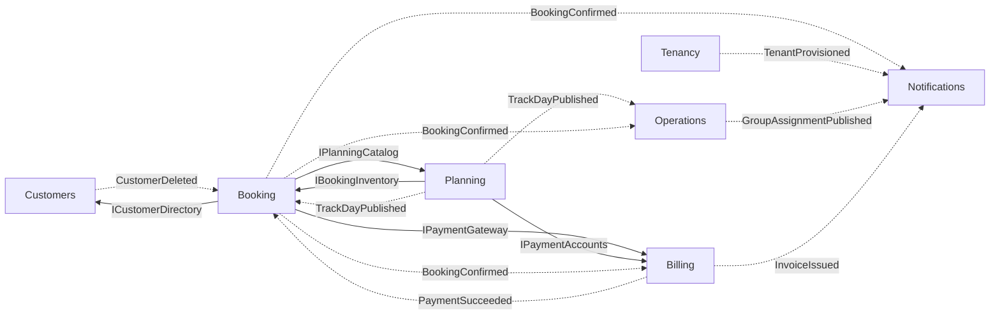
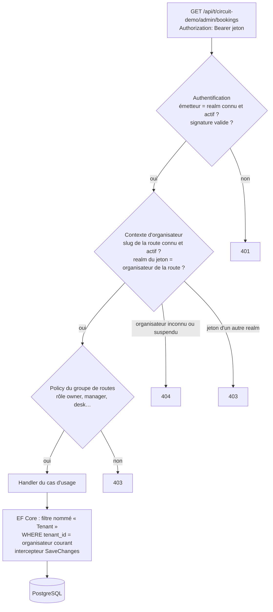
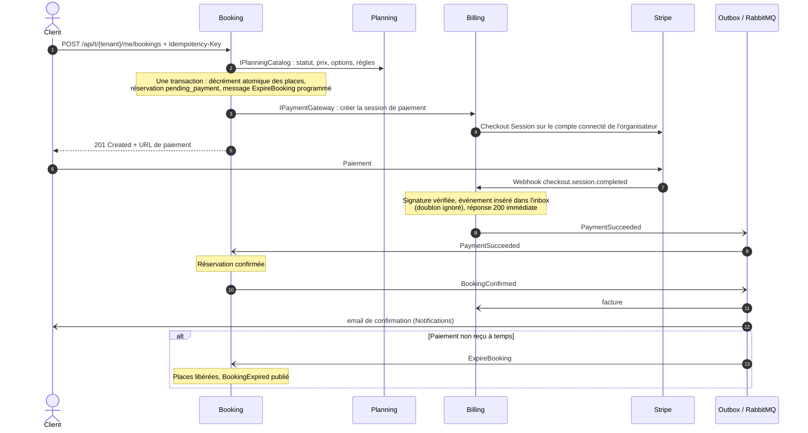

# Paddock — backend

[](https://github.com/Victor-Guillen/public-skeleton-paddock-backend/actions/workflows/ci.yml)


Backend .NET 10 d'un **SaaS de réservation de roulages, de stages de pilotage et de baptêmes** pour les circuits, les
clubs et les écoles de pilotage. **Multi-tenant**, fronts en **marque blanche** (un domaine par organisateur), **un seul
backend** : un monolithe modulaire de sept modules aux frontières vérifiées par des tests.

> **Statut : squelette public.** Le socle technique est en place et testé, l'architecture des sept modules est posée
> (projets, points d'entrée, contrats, règles d'architecture actives). Le métier est implémenté module par module.
> Les sections ci-dessous décrivent l'**architecture cible**.

## Sommaire

- [Le produit](#le-produit)
- [Points techniques clés](#points-techniques-clés)
- [Vue d'ensemble](#vue-densemble)
- [Modules](#modules)
- [Multi-tenant et sécurité](#multi-tenant-et-sécurité)
- [Parcours d'une réservation](#parcours-dune-réservation)
- [Règles d'architecture](#règles-darchitecture)
- [Conventions de l'API](#conventions-de-lapi)
- [Décisions d'architecture](#décisions-darchitecture)
- [Stack](#stack)
- [Structure de la solution](#structure-de-la-solution)
- [Démarrer](#démarrer)
- [Licence](#licence)

---

## Le produit

Deux familles d'offres :

- **Roulages** (*track days*) : le pilote vient avec **son propre véhicule**, auto ou moto, et roule par séries dans
  des **groupes de niveau** constitués par l'organisateur ;
- **Stages et baptêmes** : l'école fournit **ses véhicules et ses moniteurs**, le client réserve un **créneau**.

Le backend couvre l'offre, le planning, la réservation et le **paiement en ligne obligatoire** (Stripe, sur le compte
de l'organisateur), la facturation, les opérations du **jour J** (accueil, numéros de course, groupes, chronos,
exports) et les notifications.

Chaque organisateur publie son front de réservation **sous son propre nom de domaine**. Ses clients, ses données et ses
paiements ne sont **jamais** visibles d'un autre organisateur : un même pilote qui réserve chez deux organisateurs a
deux comptes distincts.

| Acteur | Ce qu'il fait |
|---|---|
| Visiteur | Consulte l'offre publique d'un organisateur |
| Client / pilote | Gère son profil et ses véhicules, réserve, paie, annule, télécharge billet et facture |
| Personnel (`owner`, `manager`, `desk`, `instructor`) | Offre, planning, réservations, jour J, selon son rôle |
| Super-administrateur | Crée, suspend et réactive les organisateurs |
| Stripe | Notifie paiements, remboursements et état des comptes par webhooks signés |

## Points techniques clés

| Sujet | Mise en œuvre |
|---|---|
| **Monolithe modulaire** | 7 modules, un schéma PostgreSQL et un `DbContext` par module, frontières vérifiées en CI |
| **Multi-tenant sécurisé** | Un realm Keycloak par organisateur, jetons multi-émetteurs, filtre EF Core nommé toujours actif, suite d'isolation qui découvre seule chaque endpoint |
| **Cohérence sans « vérifier puis écrire »** | Décrément atomique conditionnel et contrainte `CHECK` (zéro survente), index uniques partiels, contrainte d'exclusion PostgreSQL |
| **Messaging fiable** | Événements d'intégration publiés par **outbox** dans la transaction métier, consommateurs idempotents, messages programmés |
| **Paiement** | Stripe Connect (charges directes), webhooks vérifiés avec inbox anti-doublon, confirmation uniquement par webhook, paiement tardif |
| **Facturation** | Montants en centimes, prix TTC, TVA figée à la réservation, numérotation continue sans trou |
| **Algorithmique** | Brassage déterministe des pilotes en groupes de niveau (service de domaine pur, testé en profondeur) |
| **Qualité** | Warnings = erreurs, API interdites par analyseur (`DateTime.Now`, `.Result`…), tests unitaires, d'intégration et d'architecture, CI GitHub Actions |
| **Observabilité** | OpenTelemetry de bout en bout (HTTP, base, messages), dashboard Aspire |

---

## Vue d'ensemble



- **Un processus** (`Paddock.Api`) héberge l'API HTTP, les hubs SignalR, les consommateurs de messages et les jobs
  planifiés. Les extraire dans un worker ne demande aucune modification des modules.
- **Un processus éphémère** (`Paddock.MigrationService`) applique les migrations de chaque module, puis s'arrête ;
  l'API attend sa fin pour démarrer.
- **Un orchestrateur local** (`Paddock.AppHost`, .NET Aspire) lance tout l'environnement de développement en une
  commande.

---

## Modules



Trait plein : **appel synchrone** d'une interface `.Contracts`, pour décider maintenant. Pointillés : **événement
d'intégration** publié par l'outbox, pour les effets de bord (extrait ; le catalogue complet est dans le README de
chaque module).

| Module | Schéma | Possède | Contrats synchrones |
|---|---|---|---|
| [Tenancy](src/Modules/Tenancy/README.md) | `tenancy` | organisateurs, domaines, réglages, documents légaux, personnel, provisionnement Keycloak | `ITenantDirectory` |
| [Customers](src/Modules/Customers/README.md) | `customers` | profils, véhicules | `ICustomerDirectory` |
| [Planning](src/Modules/Planning/README.md) | `planning` | circuits, formules, options, journées, ressources, créneaux | `IPlanningCatalog`, `IPlanningCalendar` |
| [Booking](src/Modules/Booking/README.md) | `booking` | inventaires, réservations, idempotence, annulations de masse | `IBookingInventory`, `IBookingQueries` |
| [Billing](src/Modules/Billing/README.md) | `billing` | comptes connectés, paiements, remboursements, inbox Stripe, factures, avoirs | `IPaymentGateway`, `IPaymentAccounts` |
| [Operations](src/Modules/Operations/README.md) | `operations` | listes de participants, numéros de course, check-in, groupes, chronos, exports | `IRosterQueries` |
| [Notifications](src/Modules/Notifications/README.md) | `notifications` | journal des envois, gabarits | — |

Chaque module suit la même forme :

```
src/Modules/Booking/
  Paddock.Modules.Booking/              implémentation : tout est internal
    BookingModule.cs                    point d'entrée public : AddBookingModule() / MapBookingModule()
    Domain/                             entités, value objects, règles : C# pur, sans framework
    Features/<Zone>/<Cas>.cs            un fichier par cas d'usage : requête, validateur, handler, endpoint
    Features/<Zone>/<Evenement>Consumer.cs   un fichier par consommateur d'événement
    Infrastructure/                     DbContext, configurations EF Core, migrations, adaptateurs externes
  Paddock.Modules.Booking.Contracts/    API publique du module
    IBookingInventory.cs                interfaces synchrones
    IntegrationEvents/                  événements d'intégration (records immuables, au passé)
```

---

## Multi-tenant et sécurité



- **Un organisateur = un realm Keycloak** ; l'API accepte les jetons de tous les realms actifs. Les clés de signature
  de chaque realm sont chargées et mises en cache par realm.
- Le `TenantId` vient **uniquement** du contexte résolu par le middleware, jamais du corps de la requête.
- Chaque entité d'un organisateur porte un `tenant_id` ; le **filtre de requête nommé** `"Tenant"` d'EF Core 10 est
  toujours actif, et un intercepteur `SaveChanges` renseigne `TenantId` et refuse toute écriture sur les données d'un
  autre organisateur.
- Une ressource d'un autre organisateur répond **`404`** (son existence n'est pas révélée).
- Une **suite d'isolation** découvre automatiquement chaque endpoint `/me` et `/admin` et l'appelle avec l'identité
  d'un autre organisateur : un nouvel endpoint est couvert sans écrire de test.
- Une **fallback policy** exige un utilisateur authentifié : un endpoint oublié n'est jamais public par accident.
- Aucune donnée personnelle (email, téléphone, n° de permis) dans les logs : rédaction automatique.

| Préfixe | Accès |
|---|---|
| `/api/public/…`, `/api/t/{tenant}/public/…` | anonyme, rate limiting par IP |
| `/api/t/{tenant}/me/…` | client authentifié du realm de l'organisateur |
| `/api/t/{tenant}/admin/…` | personnel, selon le rôle |
| `/api/platform/…` | super-administrateur (realm `platform`) |
| `/api/webhooks/stripe` | Stripe, signature vérifiée |
| `/api/dev/…` | développement uniquement |

---

## Parcours d'une réservation



- **Zéro survente** : `UPDATE … SET held = held + n WHERE held + confirmed + n <= capacity`, et une contrainte `CHECK`
  en dernier rempart. Garantie : 50 réservations parallèles sur 10 places en confirment exactement 10.
- **La confirmation ne dépend jamais du navigateur** : seul le webhook confirme.
- **Paiement tardif** : si une place reste, la réservation est reprise atomiquement ; sinon le client est remboursé
  intégralement.
- Les événements sont enregistrés **dans la même transaction** que les données (outbox) : un plantage entre
  l'écriture en base et l'envoi du message ne perd aucun effet de bord.

---

## Règles d'architecture

| Règle | Vérifiée par |
|---|---|
| Un module ne référence que les `.Contracts` des autres modules | test d'architecture (références d'assemblies) |
| Dans un module, tout est `internal` sauf le point d'entrée, les consommateurs et le `DbContext` | test d'architecture (NetArchTest) |
| Les consommateurs `*Consumer` sont `public static` (sinon ignorés sans erreur par le bus) | test d'architecture |
| `Domain/` ne dépend ni d'EF Core, ni d'ASP.NET Core, ni de Npgsql, ni du bus, ni de Stripe | test d'architecture |
| L'hôte ne dépend d'aucun `DbContext` de module | test d'architecture |
| Aucun module n'échappe aux règles (chaque projet de `src/Modules` est inspecté) | test d'architecture |
| Le socle ne connaît ni les modules ni les hôtes | test d'architecture |
| Un schéma PostgreSQL et un `DbContext` par module, aucune clé étrangère entre schémas | revue, migrations par module |
| Heure courante via `TimeProvider` ; jamais `.Result` ni `.Wait()` | analyseur `BannedApiAnalyzers` (erreur de build) |
| Tout avertissement casse le build ; style vérifié au build | `TreatWarningsAsErrors`, `.editorconfig` |

Patterns de code :

- **Vertical slices** : un fichier par cas d'usage (requête, validateur FluentValidation, handler, endpoint Minimal
  API). Pas de mediator, pas de repository générique, pas d'AutoMapper, pas de contrôleurs MVC.
- **Erreurs métier = valeurs** : `Result<T>` / `Error`, converties en `ProblemDetails` ; les exceptions sont réservées
  à l'imprévu.
- **Synchrone pour décider, événement pour les effets de bord.**
- **Jamais « vérifier puis écrire »** pour une règle d'unicité ou de capacité : on écrit et une contrainte en base
  arbitre (`IsUniqueViolation`, mise à jour conditionnelle atomique).
- **Toute liste est paginée par curseur** (`CursorPage<T>`).
- **Argent** : `Money` en centimes, prix TTC, TVA figée à la réservation, décomposition TTC → HT + TVA exacte au
  centime.

## Conventions de l'API

- REST, OpenAPI natif d'ASP.NET Core, interface **Scalar** en développement.
- Erreurs au format **ProblemDetails** (RFC 9457) avec une extension `code` stable `<module>.<cas>`
  (ex. `booking.sold_out`) : un contrat avec les fronts, jamais renommé.
- JSON camelCase, enums en `snake_case`, montants `{ "amount": 25000, "currency": "EUR" }` en centimes.
- Instants en ISO 8601 UTC, jours en `DateOnly`, heures locales dans le fuseau de l'organisateur.
- Listes : `{ items, nextCursor, hasMore }`, paramètres `cursor` et `limit` (20 par défaut, 50 au maximum).
- Transitions d'état = commandes explicites (`POST /track-days/{id}/publish`), pas de `PATCH` du statut.

---

## Décisions d'architecture

| # | Décision | Pourquoi |
|---|---|---|
| 1 | Monolithe modulaire plutôt que microservices | Une seule personne, cohérence forte (inventaire, factures) par transactions locales ; frontières tenues par les tests, extraction d'un module toujours possible |
| 2 | REST + OpenAPI plutôt que GraphQL | Policies, rate limiting et isolation **par route** ; contrat stable pour des fronts développés par des tiers |
| 3 | Pas de mediator : l'endpoint appelle son handler injecté | Lien un pour un, flux lisible sans magie, une dépendance et une licence en moins |
| 4 | Keycloak, un realm par organisateur | Comptes clients réellement isolés entre organisateurs |
| 5 | Jetons multi-émetteurs et résolution de l'organisateur | Un seul backend pour tous les realms, sans appel réseau bloquant à la validation |
| 6 | Isolation par `tenant_id` + filtres nommés EF Core | Base partagée simple à opérer ; Row-Level Security gardée en défense supplémentaire |
| 7 | Synchrone pour décider, événements pour les effets de bord | Décisions cohérentes, effets de bord jamais perdus |
| 8 | Wolverine + RabbitMQ + outbox | Outbox, inbox et messages programmés intégrés, licence MIT (MassTransit v9 commercial) |
| 9 | L'inventaire appartient à Booking ; décrément atomique + `CHECK` | La survente est impossible même si le code applicatif se trompe |
| 10 | Stripe Connect, charges directes | L'organisateur encaisse sur son propre compte, la plateforme prélève une commission |
| 11 | Confirmation uniquement par webhook | Un onglet fermé ne fait ni perdre ni doubler une réservation ; paiement tardif traité |
| 12 | Numérotation des factures par compteur transactionnel | Obligation légale de continuité : un rollback rend le numéro |
| 13 | Contrainte d'exclusion PostgreSQL pour les ressources | Aucun chevauchement de créneaux pour un moniteur ou un véhicule, garanti par la base |
| 14 | Algorithme de brassage déterministe | Résultat reproductible et testable, verrous et mode stabilité |
| 15 | Montants en centimes, prix TTC, TVA figée à la réservation | Aucun arrondi flottant, prix affiché = prix payé |

---

## Stack

| Besoin | Choix |
|---|---|
| Runtime | .NET 10 (LTS), C# 14, nullable, warnings = erreurs |
| Orchestration locale | .NET Aspire 13.6 (PostgreSQL, pgAdmin, Keycloak, API) |
| API | ASP.NET Core Minimal APIs, OpenAPI natif, Scalar |
| Données | PostgreSQL 18, EF Core 10 + Npgsql, conventions snake_case |
| Validation | FluentValidation |
| Identité | Keycloak 26, JWT Bearer multi-émetteurs |
| Messaging | Wolverine (outbox, inbox, messages programmés) + RabbitMQ |
| Paiement | Stripe.net (Connect, Checkout, webhooks) |
| Jobs planifiés | Hangfire + PostgreSQL |
| Cache, temps réel | `HybridCache` + Redis, SignalR + backplane Redis |
| Documents | QuestPDF, QRCoder, ClosedXML, CsvHelper, Azure Blob Storage (Azurite en dev) |
| Emails | MailKit + Fluid (gabarits Liquid), Mailpit en dev |
| Observabilité | OpenTelemetry (traces, métriques, logs), dashboard Aspire |
| Tests | xUnit v3, `WebApplicationFactory`, Testcontainers (PostgreSQL, RabbitMQ, Keycloak), NetArchTest, k6 |
| Analyse statique | Analyseurs Roslyn, `BannedApiAnalyzers` |
| CI | GitHub Actions : format, build Release, tests, rapports |

Exclus volontairement : MediatR, AutoMapper, MassTransit v9+ et FluentAssertions v8+ (licences commerciales).

---

## Structure de la solution

```
Paddock.slnx
global.json · Directory.Build.props · Directory.Packages.props · BannedSymbols.txt · .editorconfig
src/
  Paddock.AppHost/                 orchestration Aspire (développement)
  Paddock.ServiceDefaults/         OpenTelemetry, health checks, résilience HTTP
  Paddock.Api/                     hôte : pipeline HTTP, assemblage des modules
  BuildingBlocks/
    Paddock.BuildingBlocks/        socle technique partagé, aucun métier
      Results/                     Result, Result<T>, Error, ErrorType
      Web/                         Result → ProblemDetails, ValidationFilter, GlobalExceptionHandler
      Pagination/                  CursorPage<T>, curseurs, taille de page
      Persistence/                 snake_case, enums, IsUniqueViolation, IModuleDatabaseInitializer
      Pricing/                     Money, VatRate, VatBreakdown
  Modules/
    Tenancy/ · Customers/ · Planning/ · Booking/ · Billing/ · Operations/ · Notifications/
tests/
  Paddock.UnitTests/               socle et domaine, sans I/O
  Paddock.IntegrationTests/        API démarrée en mémoire
  Paddock.ArchitectureTests/       règles de dépendances et d'encapsulation
infra/keycloak/                    realms de démonstration
.github/workflows/ci.yml           intégration continue
```

---

## Démarrer

**Prérequis** : SDK .NET 10 (version fixée par `global.json`), Docker, et la CLI Aspire (facultative) :

```bash
dotnet tool install --global Aspire.Cli
```

**Lancer tout l'environnement** (PostgreSQL, pgAdmin, Keycloak, API) et le dashboard Aspire :

```bash
aspire run
# ou, sans la CLI Aspire :
dotnet run --project src/Paddock.AppHost
```

| Ressource | Accès |
|---|---|
| Dashboard Aspire | URL affichée dans la console |
| API | http://localhost:5080 |
| Documentation interactive (Scalar) | http://localhost:5080/scalar |
| Health checks | http://localhost:5080/health |
| Keycloak | http://localhost:8080 (identifiants de développement de `src/Paddock.AppHost/appsettings.Development.json`) |

**Construire et tester** :

```bash
dotnet build      # warnings = erreurs
dotnet test       # tests unitaires, d'intégration et d'architecture
dotnet format     # style vérifié en CI
```

Les secrets (clé Stripe, etc.) passent par `dotnet user-secrets`, jamais par le dépôt.

---

## Licence

© 2026 Victor Guillen. **Tous droits réservés.** Le code est publié pour consultation uniquement : aucune utilisation,
copie ou redistribution n'est autorisée sans accord écrit. Voir [LICENSE](LICENSE).
